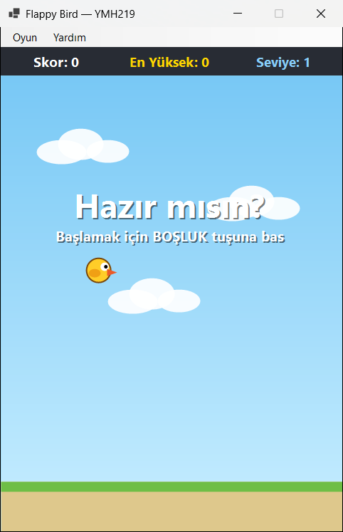
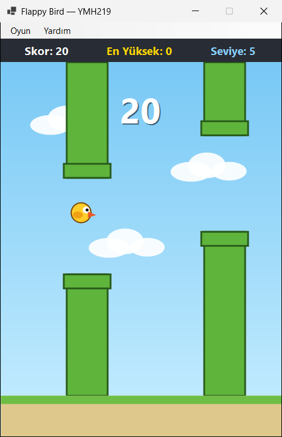
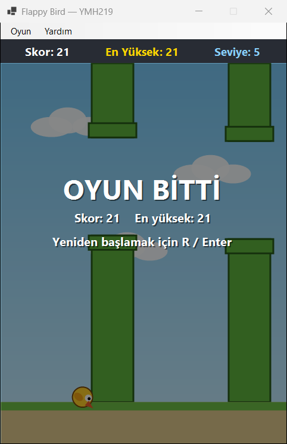

# YMH219 – Flappy Bird Benzeri Masaüstü Oyunu

Windows Forms ile yazılmış, Flappy Bird benzeri basit bir oyun. Kuş klavyeyle zıplar, yer
çekimiyle düşer; sağdan sola akan boruların arasından geçtikçe skor artar. Boruya veya zemine
çarpınca oyun biter. Oyun döngüsü bir `Timer` ile, nesneler (kuş, borular) ise ortak bir
soyut sınıftan türeyen sınıflarla yönetilir.

Nesne Tabanlı Programlama (YMH 219) dersi ek uygulama ödevi.

## Ekran görüntüleri

| Başlangıç | Oyun sırasında | Oyun bitti |
|---|---|---|
|  |  |  |

## Kullanılan teknolojiler

- C# / .NET 10 (`net10.0-windows`)
- Windows Forms: `Timer`, `PictureBox` (`Paint` olayı), `MenuStrip`, `TableLayoutPanel`
- GDI+ (`System.Drawing`): tüm görseller kodla çizilir, harici resim dosyası yoktur
- Harici NuGet paketi **yok**

## Kurulum ve çalıştırma

Gereksinim: Windows ve [.NET 10 SDK](https://dotnet.microsoft.com/download) (Visual Studio 2026 ile birlikte gelir).

**Visual Studio ile:** `FlappyBird.sln` dosyasını açın ve **F5** ile çalıştırın.

**Komut satırından:**

```powershell
git clone https://github.com/SuleymanKilincc/YMH219-FlappyBird.git
cd YMH219-FlappyBird
dotnet run --project FlappyBird
```

## Kontroller

| Tuş | İşlev |
|---|---|
| Boşluk / Yukarı ok / W / fare tıklaması | Zıpla (ilk basış oyunu başlatır) |
| P | Duraklat / devam et |
| R veya Enter | Oyun bitince yeniden başla |
| F2 | Yeni oyun |
| F3 | Demo modu (otomatik pilot) aç / kapat |

## Özellikler

- Kuş klavye ile yukarı zıplar, **yer çekimi** ile hızlanarak düşer
- Ekranda **3 boru çifti** sağdan sola akar; ekrandan çıkan boru en sağa **yeniden konumlandırılır**
- Art arda gelen boruların boşlukları arasındaki yükseklik farkı sınırlıdır (yetişilemeyecek boru çıkmaz)
- Boruya veya zemine çarpınca **Oyun Bitti** ekranı
- Her geçilen boru **+1 skor**; her 5 puanda **seviye atlanır ve borular hızlanır**
- **En yüksek skor** dosyada saklanır (`%AppData%\YMH219-FlappyBird\enyuksekskor.txt`)
- Yeni Oyun / Yeniden Başlat, Duraklat, Demo modu
- Skor, en yüksek skor ve seviye üstteki bilgi çubuğunda gösterilir

## Proje yapısı ve sınıf tasarımı

```
FlappyBird/
├── Oyun/
│   ├── OyunNesnesi.cs        # abstract: X, Y ve abstract Ciz(Graphics)
│   ├── Kus.cs                # OyunNesnesi'nden türer: hız, yer çekimi, Ziplat()
│   ├── BoruCifti.cs          # OyunNesnesi'nden türer: üst/alt boru, Hareket(), çarpışma
│   ├── OyunMotoru.cs         # oyun durumu, skor, seviye, hız, çarpışma; SkorDegisti / OyunBitti olayları
│   └── YuksekSkorDeposu.cs   # rekoru dosyaya yazar / okur
├── OyunFormu.cs              # Timer, klavye/fare/menü olayları, çizim
├── OyunFormu.Designer.cs     # form tasarımı (Visual Studio Designer)
└── Program.cs
```

- **Kalıtım ve çok biçimlilik:** `Kus` ve `BoruCifti`, soyut `OyunNesnesi` sınıfından türer.
  Form çizim yaparken her nesnenin kendi `Ciz()` metodunu çağırır.
- **Kapsülleme:** konum ve hız gibi alanların `set` erişimcisi korumalıdır (`private` / `protected`);
  değerler yalnızca `Ziplat()`, `Guncelle()`, `Hareket()` gibi metotlarla değişir.
- **Olaylar (event):** `OyunMotoru`, skor değişince `SkorDegisti`, oyun bitince `OyunBitti` olayını
  tetikler; form bunlara abone olup etiketleri günceller ve rekoru kaydeder.
- **Oyun döngüsü:** `Timer` (16 ms) her tikte `motor.Guncelle()` çağırır, sonra `PictureBox.Invalidate()`
  ile ekranı yeniden çizdirir.

## Bilinen sınırlamalar / geliştirme notları

- Ses efekti yoktur.
- Pencere boyutu sabittir; oyun alanı yeniden boyutlandırılamaz.
- Fizik hesabı kare başınadır (her tik sabit adım); bilgisayar yavaşlarsa oyun da yavaşlar.

## Öğrenci

- **Ad Soyad:** Süleyman Kılınç
- **Öğrenci No:** 250541031
